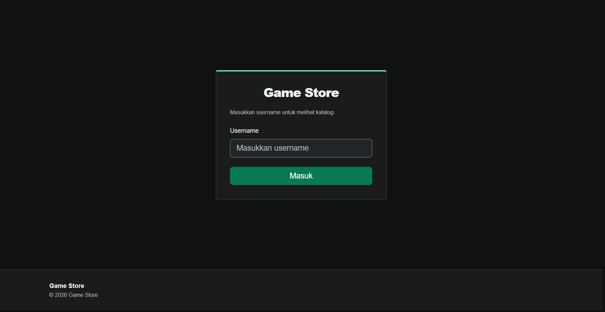
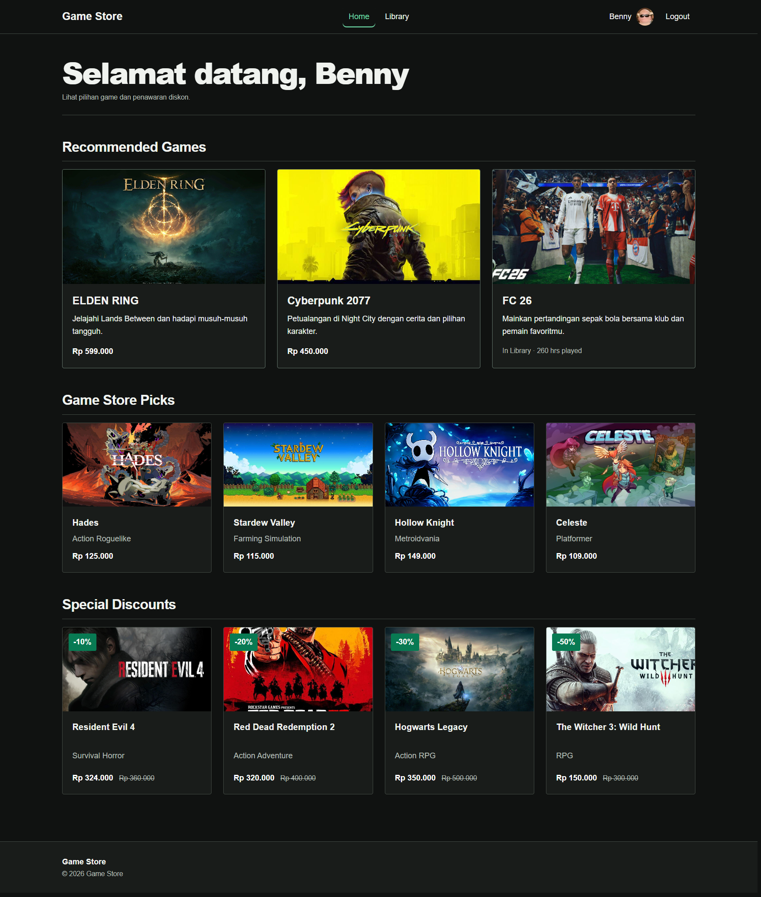
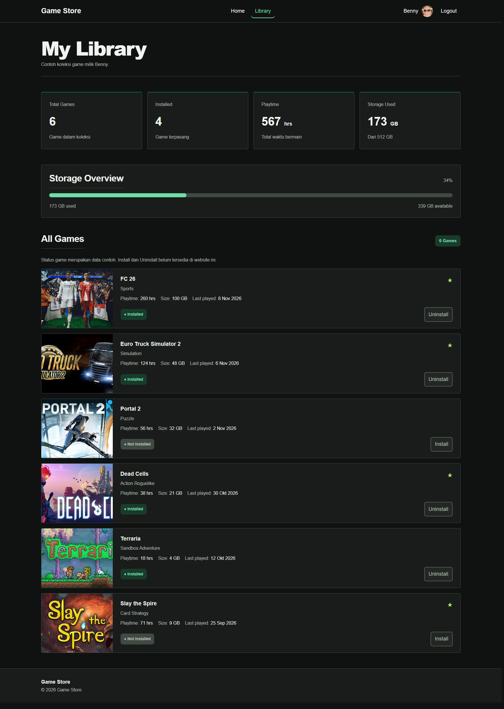
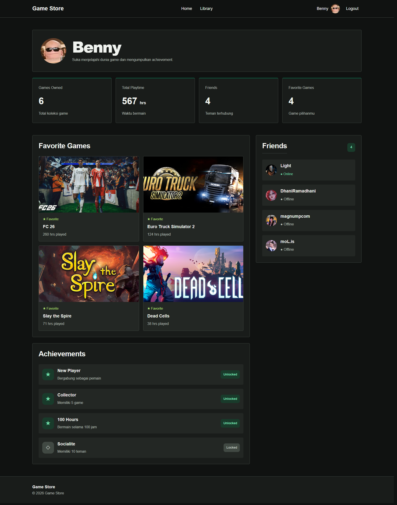

# Game Store

Game Store adalah website katalog dan koleksi game untuk proyek UTS Pemrograman Web. Website ini dibuat menggunakan Laravel dengan halaman Login, Dashboard, Library, dan Profile. Web ini mengambil referensi dari platform Steam dan Epic Games

## Tampilan

### Login



### Dashboard



### Library



### Profile



## Fitur

- **Login:** masuk menggunakan username yang dikirim melalui Request Parameter, tanpa autentikasi akun.
- **Dashboard:** menampilkan Recommended Games, Game Store Picks, serta Special Discounts.
- **Library:** menampilkan koleksi game, status terpasang, playtime, ukuran game, tanggal terakhir bermain, dan penggunaan storage.
- **Profile:** menampilkan username, avatar, statistik koleksi, Favorite Games, Friends, dan Achievements.
- **Navigasi:** username tetap terbawa saat berpindah halaman. Logout mengembalikan pengguna ke halaman Login.

Data game dan akun merupakan data simulasi dari array PHP. Tombol Install dan Uninstall belum menjalankan proses instalasi, dan website tidak membaca penyimpanan perangkat.

## Teknologi

- Laravel 12 dan PHP 8.2 atau lebih baru.
- Blade untuk layout, komponen, partial, dan perulangan data.
- Bootstrap 5 dan CSS untuk tampilan responsif.

Data aplikasi tidak memakai database, Eloquent, atau CRUD. CSS, Bootstrap, dan gambar tersedia secara lokal di folder `public`.

## Cara menjalankan

1. Buka terminal pada folder proyek dan pasang dependency:

   ```bash
   composer install
   ```

2. Jika file `.env` belum ada, salin `.env.example` menjadi `.env`. Gunakan pengaturan berikut agar session dan cache tidak membutuhkan database:

   ```dotenv
   SESSION_DRIVER=file
   CACHE_STORE=file
   QUEUE_CONNECTION=sync
   ```

3. Jika `APP_KEY` belum terisi, jalankan:

   ```bash
   php artisan key:generate
   ```

4. Jalankan server Laravel:

   ```bash
   php artisan serve
   ```

5. Buka `http://127.0.0.1:8000`, lalu masukkan username pada halaman Login.

Tidak perlu membuat database, menjalankan migration, atau menjalankan npm untuk tampilan yang digunakan proyek ini.

## Alur kode

Form Login mengirimkan `username` melalui metode GET. Route meneruskan request ke `PageController`, kemudian Controller mengambil parameter username dan menyiapkan data array untuk View. Halaman yang memerlukan username akan mengarahkan pengguna ke Login jika parameter tersebut kosong.

View memakai layout utama melalui `@extends`, mengisi konten dengan `@section`, dan menampilkannya melalui `@yield`. Partial dipanggil menggunakan `@include`, sedangkan Navbar dan Footer memakai Blade Component `<x-navbar>` dan `<x-footer>`. Daftar game ditampilkan melalui `@foreach` atau `@forelse`.

## Struktur utama

```text
routes/web.php
app/Http/Controllers/PageController.php
resources/views/
├── layouts/app.blade.php
├── login.blade.php
├── dashboard.blade.php
├── pengelolaan.blade.php
├── profile.blade.php
├── components/
│   ├── navbar.blade.php
│   └── footer.blade.php
└── partials/
    ├── head.blade.php
    ├── game-card.blade.php
    └── avatar.blade.php
```

## Referensi

- [Panduan Pelaksanaan UTS Pemrograman Web 2026](https://adyahandika.my.id/course/pemrograman-web/panduan-pelaksanaan-uts-pemrograman-web-2026).
- [Steam](https://store.steampowered.com/) dan [Epic Games Store](https://store.epicgames.com/), sebagai referensi visual untuk konsep katalog game.
